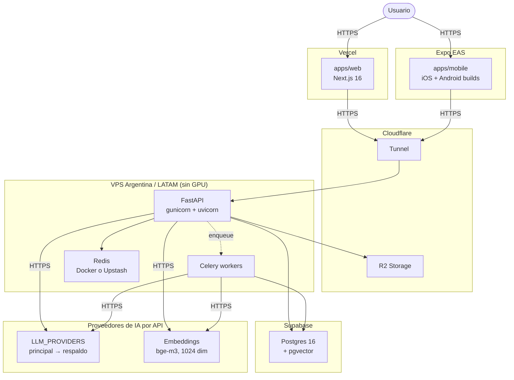

# Topología de deploy de Ynara

<!-- TODO: refinar con direcciones / puertos / firewalls específicos -->

## MVP (fase actual)

> **IA por API ([ADR-028](../adrs/ADR-028-inferencia-por-api.md)).** La VPS no
> tiene GPU ni sirve modelos. El chat, el agente y la consolidación de memoria van
> contra los proveedores de `LLM_PROVIDERS`, en orden de prioridad (principal →
> respaldo), y los embeddings (bge-m3, 1024 dimensiones) contra el proveedor de
> `EMBEDDING_BASE_URL`. La única HTTP a proveedores sale de
> `apps/backend/app/llm/clients/providers/` (regla #4b), y hasta cerrar las
> compuertas de ADR-028 reciben solo datos sintéticos. En dev y CI corren los
> clientes fake, sin red.

## V2 (post-validación)

Mismo diagrama pero `SB` (Supabase) reemplazado por un Postgres
self-hosted en la misma VPS o en VPS dedicada (ADR-005). La IA sigue
por API. Detalle del cutover en
`docs/operations/MIGRATION-SUPABASE-TO-SELFHOSTED.md`.

## Notas

- El API usa la IA en el path del chat (el alias del modo, y los embeddings
  para buscar en memoria y para las tools `memory.*`) y los workers en la
  consolidación (el alias `agente` y los embeddings de lo que se guarda).
  Variables, credenciales y fail-fast de production en
  [`infra/prod/README.md`](../../../infra/prod/README.md#proveedores-de-ia).
- Si el principal falla, el chat pasa al respaldo y, agotada la cadena,
  responde degradado; la consolidación reintenta desde Celery. Los
  embeddings no tienen respaldo. Qué hacer en cada caso:
  [`RUNBOOK.md`](../../operations/RUNBOOK.md#proveedor-de-ia-lento-o-caído).
- El reranker no es un servicio: es un passthrough en todos los entornos
  (ADR-028 D5).
- Cloudflare Tunnel evita abrir puertos en la VPS y oculta IP real.
- R2 para storage de exports de usuario, backups cifrados, assets
  estáticos pesados.
