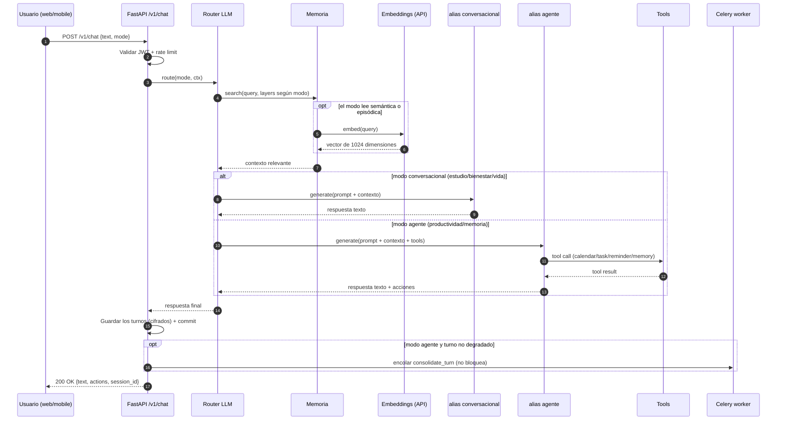

# Flujo de un mensaje en Ynara

<!-- TODO: refinar con detalle de auth, rate limits, telemetría -->

## Notas

- La extracción y consolidación de memoria episódica/procedural va
  **siempre asíncrona** vía Celery (regla extendida en
  `docs/conventions/AI-GUIDELINES.md`).
- El alias `conversacional` nunca escribe memoria ni llama tools; solo
  `agente` lo hace. Por eso solo se consolidan los turnos de los modos con
  `agente` (`consolidate_turn`); el resumen episódico de cualquier sesión
  lo escribe `agente` en el worker al cerrarla (`consolidate_session`).
- El router toma el alias de `ynara.config.json[modes][...].model`, y
  cada proveedor de `LLM_PROVIDERS` lo traduce a su id de modelo.
- **Rate-limit YA está activo** (`app/core/ratelimit.py`): chat por
  `user_id`, login/register/refresh por IP, export/wipe/sessions por
  `user_id`. El paso `Validar JWT + rate limit` del diagrama es estado
  actual, no objetivo.
- **Los dos alias se sirven por API**
  ([ADR-028](../adrs/ADR-028-inferencia-por-api.md)), con la cadena
  principal → respaldo → respuesta degradada: si se agota, el chat
  responde degradado (`finish_reason: "degraded"`) y ese turno no se
  consolida. Los embeddings no tienen respaldo (ver
  [`RUNBOOK.md`](../../operations/RUNBOOK.md#proveedor-de-embeddings-caído)).
  En dev y CI corren los clientes fake: sin un proveedor, el chat de dev
  no contesta (ver
  [`LOCAL-DEV.md`](../../operations/LOCAL-DEV.md#ia-en-desarrollo-fake-por-default)).
